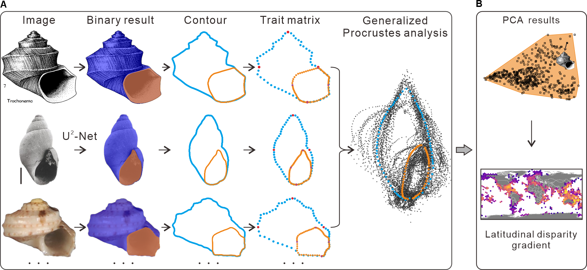

# DeepMorph-G
**Morphological analysis of gastropod shell outline and aperture.** 1) We collected gastropod images and encoded species names in the filenames; 2) U2-Net was used to extract binary masks of the shells; 3) `landmarks extraction.py` was run separately on the shell-outline and aperture-outline images to extract contours, from which 8 landmarks and 160 semi-landmarks were digitized and saved as coordinates; 4) Procrustes alignment and PCA were performed in the R package `geomorph`, and disparity was used to quantify morphology. Compared with DeepMorph, the new model produces more accurate gastropod shell and aperture boundaries, yielding more reliable landmark configurations and disparity estimates.




## How to use DeepMorph-G
1. Prepare the DeepMorph environment based on the requirements.txt. The DeepMorph was implemented in Python (> 3.6.5), Pytorch (v. 1.10.2), and torchvision (v. 0.11.3+cu113).
 
3. U2-Net was used to segment shell areas by running the u2net_test.py. Run this script separately to extract the shell outline and aperture morphology of gastropods. Please add your model and image path accordingly. 
 ```
python .../u2net_test.py
```
3. Then, the contours of the shell can be extracted using landmarks_extraction.py. ps change to your path of the binary image file obtained from the second step. Shell contours will be saved as coordinates in a CSV file. Among them, eight landmarks and 160 will be extracted as shown in the figure above (trait matrix). Here, I only used one standard view for each specimen.  
 ```
python .../landmarks extraction.py
```
4. Generalized Procrustes analysis (GPA) was conducted to align shells and remove the size effect. We can calculate the disparity of different subsets, as demonstrated in deepmorph-g for pca data.R. Please note that the gastropods_curveslide_combined.csv used to describe the relative positions of semi-landmarks. Its quantity and order must correspond with the coordinates extracted from the landmarks_extraction.py. Here, both of them need to be consistent.

## Citation
Liu X et al., A latitudinal morphological diversity gradient in marine gastropods. 
